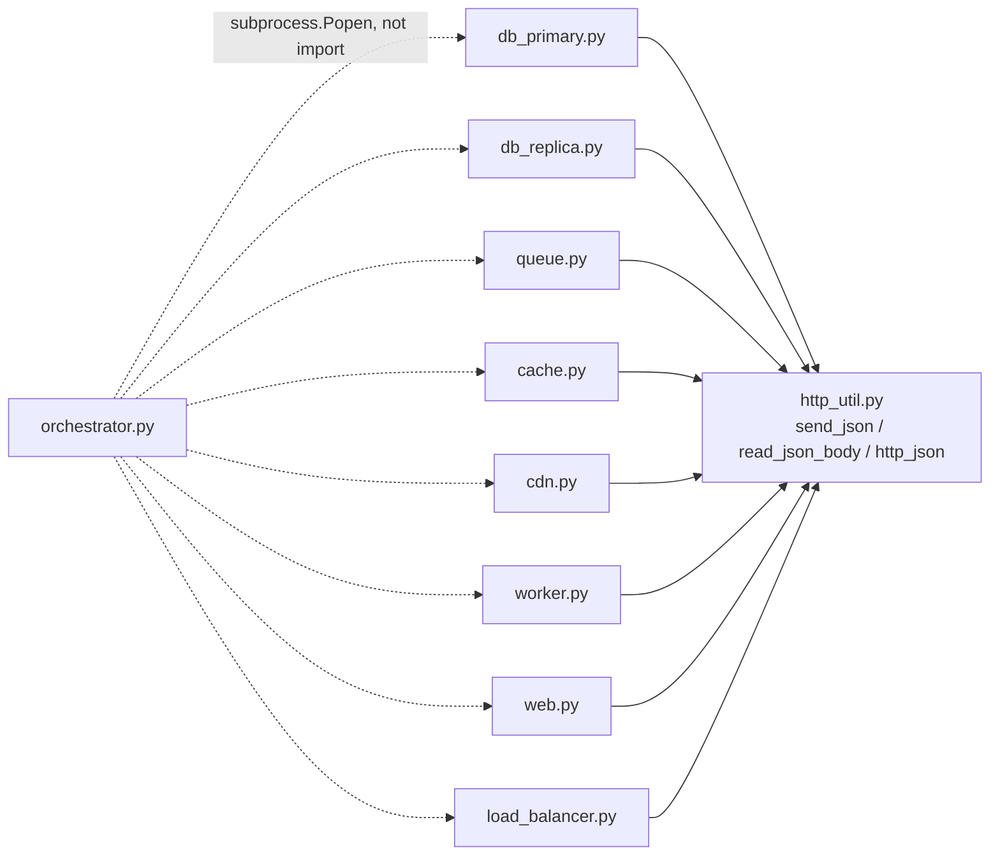
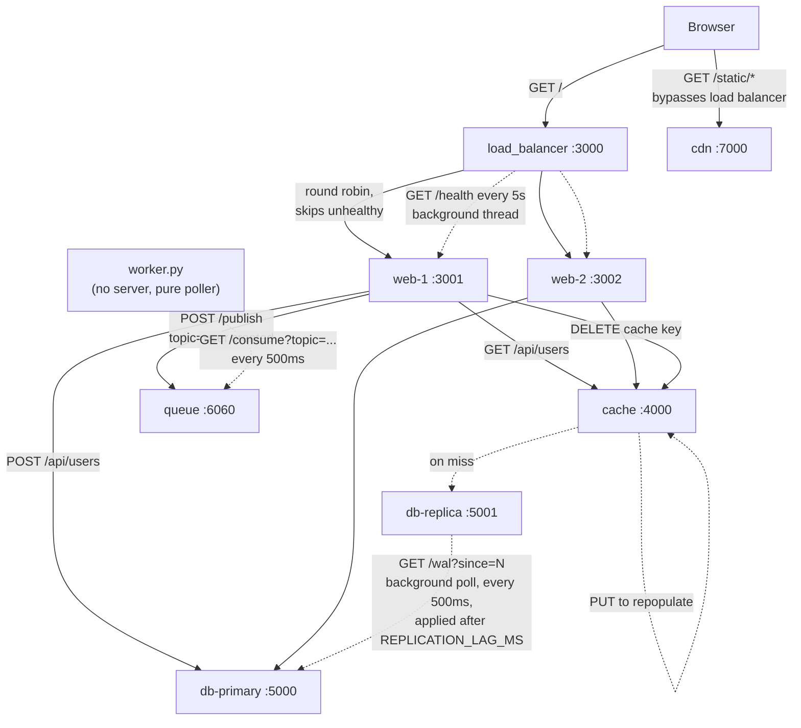

# Code Walkthrough & Invocation Graph

A step-by-step explanation of every Python file in this project, plus a graph
of which services/modules call which. This is a companion to `README.md`,
which covers *what* the project is; this file covers *how the code itself is
wired together*.

## File-by-file walkthrough

### `services/http_util.py`
The only file with no HTTP server of its own — a shared toolbox imported by
every other service.

- `send_json(handler, status, payload)` — writes a JSON HTTP response
  (status line, `Content-Type`, `Content-Length`, body) on top of the raw
  `http.server` API, which normally makes you do this by hand.
- `read_json_body(handler)` — reads `Content-Length` bytes off the request
  and parses JSON.
- `http_json(method, url, payload)` — a `urllib.request` wrapper that
  behaves like a `fetch()` call: it returns `(status, body)` for *any* HTTP
  status, including 4xx/5xx, only raising on real network failure
  (connection refused, timeout).

### `services/db_primary.py`
The write path of "database replication."

- Holds `users` (in-memory list) and a `wal` (write-ahead log) list, guarded
  by a `threading.Lock`.
- `POST /users` validates `name`, appends the row, appends a WAL entry
  `{seq, type, row, ts}`, returns 201.
- `GET /wal?since=N` lets a replica ask "what changed after sequence N" —
  this is the replication feed.
- `GET /users` and `GET /health` round it out.

### `services/db_replica.py`
The read path.

- A background thread (`poll_primary`) polls
  `PRIMARY_URL/wal?since=last_applied_seq` every 500ms.
- Each new WAL entry is applied via
  `threading.Timer(REPLICATION_LAG_MS/1000, apply_entry, ...)` —
  deliberately delayed (default 1200ms) so replication lag is *visible*, not
  just theoretical.
- Serves `GET /users` from its own copy, plus `GET /status` reporting lag.

### `services/queue.py`
A minimal pub/sub broker.

- `queues` is a `dict[topic] -> list[job]`.
- `POST /publish` appends `{payload}` under a topic and returns the new
  queue depth.
- `GET /consume?topic=X` pops the oldest job (FIFO) or returns 204 if empty
  — this is polling-based consumption, not push.

### `services/cache.py`
Stands in for Redis/Memcached.

- `store` is `dict[key] -> (value, expires_at)`.
- `GET /cache/:key` checks expiry lazily (on read) and evicts if stale,
  tracking `hits`/`misses` in `/stats`.
- `PUT /cache/:key` writes with a `ttlMs` (default 10s); `DELETE /cache/:key`
  invalidates.

### `services/cdn.py`
Static asset server.

- Subclasses `SimpleHTTPRequestHandler` (which already serves files from
  disk) rather than reimplementing file serving.
- Strips a `/static/` prefix, and `end_headers()` injects a one-year
  immutable `Cache-Control` header — the entire point of a CDN tier: assets
  that never change shouldn't be re-fetched or re-validated.
- `functools.partial(Handler, directory=PUBLIC_DIR)` is used to bind the
  served directory, because `SimpleHTTPRequestHandler.__init__` always
  resets `self.directory` to `os.getcwd()`, so setting it as a class
  attribute wouldn't stick.

### `services/worker.py`
The queue's consumer.

- No HTTP server at all — just an infinite `while True: poll(); sleep(0.5)`
  loop.
- Polls `GET /consume?topic=user.created`; on a job, sleeps 0.8s to simulate
  a slow third-party call (sending a welcome email) *off* the request path.

### `services/web.py`
The stateless application tier, where the business logic actually lives.

- `GET /api/users`: cache-aside pattern — check cache; on **miss**, read
  from the **replica** (never the primary) and repopulate the cache with an
  8s TTL.
- `POST /api/users`: writes always go to the **primary**, then the handler
  deletes the `users:all` cache key (avoiding a stale read) and publishes a
  `user.created` job to the queue (offloading the slow email step).
- Also serves `/`, `/config.json` (tells the browser where the CDN lives),
  and tags every response with `x-served-by: NODE_ID` so you can see
  *which* web instance handled a request.

### `services/load_balancer.py`
Round-robin reverse proxy.

- `check_health()` background thread pings `GET /health` on each backend
  every 5s and marks it `healthy: True/False`.
- `pick_backend()` filters to only healthy backends and round-robins via a
  shared `next_index`.
- `_proxy()` (bound to all four HTTP verbs) reads the incoming request,
  opens a raw `http.client.HTTPConnection` to the chosen backend, forwards
  headers (stripping hop-by-hop ones), and streams the response back — a
  hand-rolled reverse proxy.

### `orchestrator.py`
The entry point that ties it all together.

- `SERVICES` is a list of `(name, script, env_overrides)` tuples wiring up
  ports and downstream URLs (e.g. `web-1` gets `CACHE_URL`, `PRIMARY_URL`,
  `REPLICA_URL`, `QUEUE_URL`, `CDN_URL`).
- Spawns each as a real OS subprocess via `subprocess.Popen`, giving each
  its own color-coded log prefix streamed through a daemon thread per
  process.
- On `Ctrl+C`, terminates and waits on every child process.

> **Insight:** The whole repo deliberately avoids a single process with
> function calls — every "component" is a separate `subprocess.Popen`
> talking over real HTTP sockets on `127.0.0.1`. That's *why*
> `http_util.py` exists at all: in a monolith you'd just call a function,
> but here even a "cache lookup" is a real network round-trip with its own
> possible failure mode (see the `try/except` around every downstream call
> in `web.py`). This is what makes replication lag, cache invalidation
> races, and backend health checks *observable* instead of hypothetical.

## Invocation graph

### 1. Python import graph (who `import`s whom)

A flat star — every service imports only `http_util`, nothing imports
another service:

### 2. Runtime HTTP call graph (who calls whom over the network)

This is the graph that actually matters for understanding the system —
it disagrees with the import graph because it captures *behavior*, not
just source dependencies:

> **Insight:** Notice the two graphs disagree on what's "connected": the
> *import* graph is a flat star (everything depends only on `http_util`),
> but the *runtime* graph is a directed pipeline with two independent
> background loops (`db-replica` polling `db-primary`, `worker` polling
> `queue`) plus a request-time fan-out from `web.py`. This split is exactly
> why microservice systems are hard to reason about from source code alone
> — reading `web.py` alone tells you it calls four URLs, but only running
> the system (or drawing this graph) reveals the *timing* relationships,
> like the fact that a `GET /api/users` immediately after a
> `POST /api/users` can still return stale data for up to
> `REPLICATION_LAG_MS`, cache TTL notwithstanding, since the delete only
> clears the cache key, not the replica's lag.

## Tracing the graph step by step

The diagrams above show *what* talks to *what*; this section walks through
*when*, in the order things actually happen when you run
`python orchestrator.py` and open the page.

### Step 0 — Startup (before any request)

1. `orchestrator.py:53` spawns all 9 services as separate OS processes
   (`cache`, `db-primary`, `db-replica`, `queue`, `cdn`, `worker`, `web-1`,
   `web-2`, `load-balancer`), each with its own env vars telling it where
   its dependencies live.
2. The moment `db-replica` starts, it kicks off `poll_primary()` on a
   background thread (`services/db_replica.py:69`) — this loop runs
   forever, independent of any user request.
3. The moment `worker` starts, it enters its own infinite loop
   (`services/worker.py:32-34`) polling the queue — also independent of any
   user request.
4. The moment `load-balancer` starts, it kicks off `check_health()` on a
   background thread (`services/load_balancer.py:89`) — polling `web-1`
   and `web-2` every 5s.

These three loops (steps 2-4) are the dotted arrows in the diagram — they
run continuously, whether or not a browser ever connects.

### Step 1 — Browser loads the page

5. **`Browser → load_balancer :3000`** (`GET /`) — the only entry point a
   client ever talks to directly.
6. **`load_balancer → web-1` or `web-2`** — `pick_backend()`
   (`load_balancer.py:26`) filters to backends currently marked `healthy`
   (as decided by step 4's loop) and round-robins between them. `_proxy()`
   then opens a raw socket to whichever one it picked and streams the
   request through, response back.
7. The chosen web instance returns `frontend/index.html` verbatim
   (`web.py:39`). The browser now has the page and reads `x-served-by` in
   the response headers to know which node answered.

### Step 2 — Browser fetches static assets

8. **`Browser → cdn :7000`** directly, *bypassing the load balancer
   entirely*. The browser learned the CDN's URL from `GET /config.json`
   (`web.py:36`), which is a value the web tier just echoes back from its
   own `CDN_URL` env var — it never proxies the actual asset bytes.

### Step 3 — A read: `GET /api/users`

9. **`Browser → load_balancer → web-N`** — same round-robin hop as step 6.
10. **`web-N → cache :4000`** (`GET /cache/users:all`, `web.py:57`) —
    cache-aside pattern, check cache first.
11. **On a cache hit**, the chain stops here — `web.py:59` returns the
    cached value immediately, no database ever touched.
12. **On a cache miss**, **`web-N → db-replica :5001`** (`GET /users`,
    `web.py:61`) — reads always go to the replica, *never* the primary, so
    the primary is free to handle writes.
13. **`web-N → cache :4000`** again (`PUT /cache/users:all`, `web.py:62`)
    — repopulates the cache with an 8s TTL so the next read (step 10) hits.

### Step 4 — A write: `POST /api/users`

14. **`Browser → load_balancer → web-N`** — same hop as step 6.
15. **`web-N → db-primary :5000`** (`POST /users`, `web.py:80`) — writes
    always go to the primary. `db_primary.py:56-62` appends the row *and*
    a WAL entry in the same locked block.
16. **`web-N → cache :4000`** (`DELETE /cache/users:all`, `web.py:84`) —
    invalidates the stale cached list so step 11 won't serve outdated data.
17. **`web-N → queue :6060`** (`POST /publish`, `web.py:85`) — publishes a
    `user.created` job and returns `201` to the browser *without waiting*
    for the email step. This is the payoff of the queue: the HTTP response
    in step 14 completes here, fast.

### Step 5 — The write propagates asynchronously (background, after step 15)

18. **`db-replica → db-primary`** — the loop from step 2 wakes up, calls
    `GET /wal?since=last_applied_seq` (`db_replica.py:37`), sees the new
    WAL entry from step 15.
19. `db-replica` schedules `apply_entry` via
    `threading.Timer(REPLICATION_LAG_MS/1000, ...)` (`db_replica.py:40`) —
    the row becomes visible to reads (step 12) only after this delay
    (default 1200ms), which is why a `GET` immediately after a `POST` can
    still miss the new user even though the cache was already invalidated
    in step 16.

### Step 6 — The queued job gets processed (background, after step 17)

20. **`worker → queue`** — the loop from step 3 wakes up, calls
    `GET /consume?topic=user.created` (`worker.py:19`), pops the job
    published in step 17.
21. `worker` sleeps 0.8s to simulate a slow email API call, then logs
    completion (`worker.py:24-25`) — entirely decoupled from the original
    `POST` request, which already returned to the browser back in step 17.

> **Insight:** Steps 15-17 all happen *synchronously* inside one
> `POST /api/users` request (the browser waits for all three), while steps
> 18-21 happen *asynchronously* on two separate background loops that
> started at process boot and never stop. This is the core distinction the
> book chapter is teaching: putting something "in the queue" doesn't mean
> it happens later within the same request — it means a completely
> different process, on its own clock, will eventually pick it up. The
> request/response cycle has zero awareness of whether `worker.py` is even
> running.
